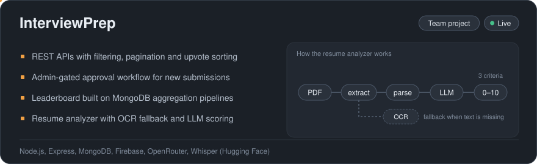
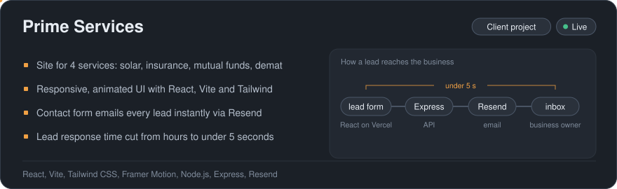
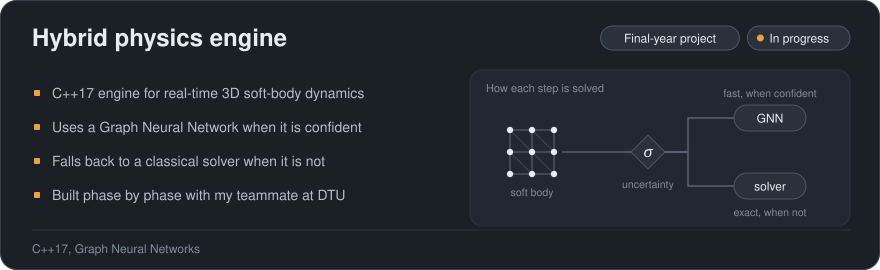

I'm a final-year IT student at Delhi Technological University. Most of my work happens on the backend: designing REST APIs, handling auth and data, and wiring AI features like LLM scoring and speech-to-text into products people actually use.

## Experience

**SDE Intern, Profices Technologies** &nbsp;Chandigarh, Jun to Jul 2026

Built the REST APIs for an application management module in Node.js, Express and MongoDB, covering application submission, lookup by job or candidate, and status tracking. Secured them with JWT authentication and role-based authorization, added input validation and duplicate-application checks, and verified every endpoint with Postman test cases.

## Projects

<a href="https://github.com/Aditya1609-design/InterviewPrep-main">Code</a> &nbsp;|&nbsp; <a href="https://interview-prep-ten-jade.vercel.app/">Live site</a>

<a href="https://github.com/Aditya1609-design/prime-services">Code</a> &nbsp;|&nbsp; <a href="https://prime-services-lyart.vercel.app/">Live site</a>

<a href="https://github.com/Aditya1609-design/hybrid-physics">Code</a>

## Problem solving

851+ problems solved across LeetCode, CodeChef, GeeksforGeeks and CodeStudio. On CodeChef I compete regularly, with a peak rating of 1574 (2★) and a global rank of 341 in Starters 250 out of more than 20,000 participants.

## Skills

**Languages:** C, C++, JavaScript, SQL 
**Backend:** Node.js, Express, MongoDB, REST APIs, JWT authentication 
**Frontend:** React, Vite, Tailwind CSS 
**AI:** LLM integration, prompt engineering, embeddings, RAG basics 
**System design:** HLD, LLD, SOLID principles, design patterns 
**Fundamentals:** Operating systems, DBMS, computer networks, OOP 
**Tools:** Git, GitHub, Postman, Vercel

## Get in touch

I'm looking for backend and SDE roles starting 2027. Reach me on [LinkedIn](https://www.linkedin.com/in/aditya-yadav-a30683290/), by [email](yadav16092004@gmail.com), or through my [portfolio](https://portfolio-liard-beta-delpmh8guz.vercel.app/).

  <source media="(prefers-color-scheme: dark)" srcset="https://raw.githubusercontent.com/Aditya1609-design/Aditya1609-design/output/github-snake-dark.svg" />
  
</picture>
