I'm a final-year IT student at Delhi Technological University. I like the part of software that users never see: the APIs, the data pipelines, and the logic that has to keep working once real people start using it. This summer I interned as a software developer at Profices Technologies, building web apps on the MERN stack.

## Things I've built

#### [InterviewPrep](https://github.com/Aditya1609-design/REPO-NAME)
An interview practice platform with AI resume analysis, mock interviews and a leaderboard. I owned the backend. The hardest part came after launch, when real users uploaded resumes in every format imaginable, so the parsing runs through Tesseract OCR with fallback handling for the cases that kept breaking. LLM calls go through OpenRouter, spoken answers are transcribed with Whisper, and the leaderboard is a MongoDB aggregation pipeline.

Node.js, Express, MongoDB, Firebase Auth, OpenRouter, Whisper, Tesseract

#### [Hybrid physics engine](https://github.com/Aditya1609-design/hybrid-physics)
My final-year project, built with a teammate. It's a C++17 engine for real-time soft-body simulation that switches between a Graph Neural Network and a classical solver, depending on how confident the network is. The idea is to get the network's speed where it's safe and the solver's accuracy where it isn't. The block at the top of this page is a nod to it. Still in progress.

C++17, Python, Graph Neural Networks

#### [Prime Services](https://github.com/Aditya1609-design/REPO-NAME)
A lead-generation website for a financial services business, live in production. The React frontend is hosted on Vercel, and an Express API on Render captures leads and delivers them by email through Resend.

React 19, Vite, Tailwind, Framer Motion, Express, Resend

## Tools I reach for

**Backend:** Node.js, Express, MongoDB, Firebase, SQL 
**Languages:** C++ (my go-to for DSA), JavaScript, Python 
**Frontend:** React, Next.js, Tailwind, Vite 
**AI:** OpenRouter, Hugging Face, Tesseract, scikit-learn 
**Shipping:** Vercel, Render, Git

## Say hello

I'm looking for backend and SDE roles starting 2027. The quickest way to reach me is [LinkedIn](https://www.linkedin.com/in/aditya-yadav-a30683290/) or [email](mailto:yadav16092004@gmail.com).

<!--
Contribution snake (your workflow still generates it). Delete these comment markers to show it again.
<picture>
  <source media="(prefers-color-scheme: dark)" srcset="https://raw.githubusercontent.com/Aditya1609-design/Aditya1609-design/output/github-snake-dark.svg" />
  
</picture>
-->
